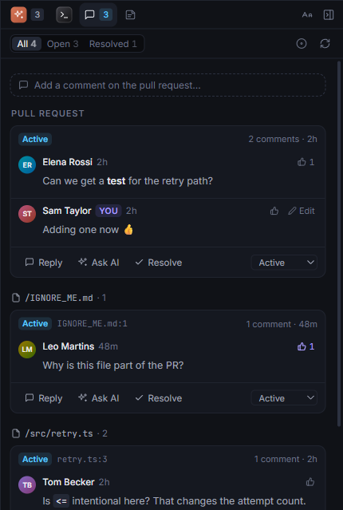
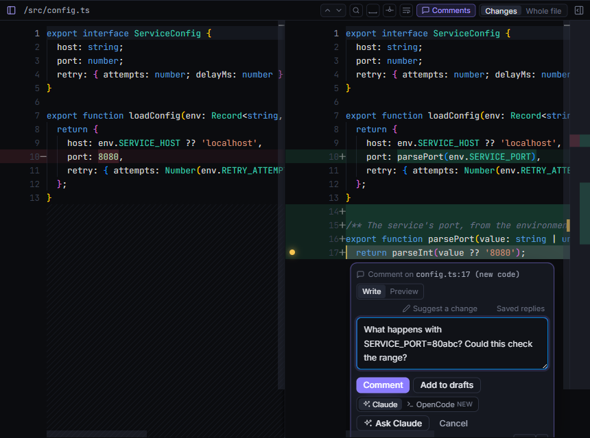

# Comments

## The PR's threads

The **Comments** tab of the panel lists every thread on the PR, yours included: who said what, the replies, and the thread's status. Click a thread's `file:line` to see its lines in the diff.

From here you can:

- **reply** to a thread;
- **resolve** it, or reactivate it (on Azure DevOps there are other statuses too, such as won't fix);
- **reply and resolve** in one go: write the reply, then **Reply and resolve** ("Fixed in the latest push");
- **like** a comment (👍 beside it), or take your like back: the 👍 shows how many liked it, and hovering it shows who (on GitHub it's the 👍 reaction);
- **edit** or **delete** your own comments. Deleting removes the comment for everyone on the PR and can't be undone; replies to it stay;
- write a **new comment** on the PR.

Each of these shows a confirmation with exactly what will change before anything is posted. Or keep your comments and replies in your drafts and post them together: see [Drafts](#drafts).

On GitHub, comments from bots that post test results, coverage and the like (github-actions, Dependabot, SonarCloud…) are hidden, and left out of the counts. The bot button at the top of the tab says how many there are, and shows them or hides them again. Code reviewers such as Copilot always show, like people's comments, and so does a bot's comment once someone replies to it.

**Ask AI** on a thread asks an agent about it. See [Asking the agent](ask.md#about-a-comment-thread).

## Answer your reviewers

On **your own PR**, the threads your reviewers left open can be answered together. The **Comments** tab says how many there are (**3 open threads from your reviewers · Answer them…**). **Answer your reviewers…** in the menu next to **Complete…**, and <kbd>Ctrl</kbd>+<kbd>K</kbd> ("Answer your reviewers on this PR…"), open the same dialog.

1. Pick the agent and, if you like, tell it something it should know ("we keep the old API until v3"), then **Read the threads**. It reads every open thread someone else started (yours and resolved ones are left out), with the code at the PR's head and the PR's commits. It only reads.
2. For each thread it proposes what to do, with a line on what it found:
   - **Fix it**: the reviewer is right, and the code should change;
   - **Reply**: a question to answer, or something to explain, with the answer drafted;
   - **Push back**: the code is right as it is, with a polite reason drafted;
   - **Already done**: a commit on the PR does it already (it names the commit), with a short reply drafted.
3. Change anything: the action, the reply (in your words), or untick a thread to leave it out.
4. Then, for the threads ticked:
   - **Add N replies to drafts** puts the replies (for **Reply**, **Push back**, and a **Fix it** you wrote a reply for) in your [drafts](#drafts), marked with the agent's name. You post them from **Post…**, under its one confirmation.
   - **Reply and resolve N…** posts the reply to each **Already done** thread and resolves it, after a confirmation that lists them, each with its reply.
   - **Send N to fix mode** opens [fix mode](fix-mode.md) with those threads in its message box: each thread's place, the reviewer's words and what to do. Start fixing, read it, and send it.

Each thread shows what's been done with it already (**In your drafts**, **Replied and resolved**, **Sent to fix mode**), so nothing goes twice. Reading the threads posts nothing; it costs what a question to the agent costs, and counts in **Usage and spend**. The reviewers' words go to the agent as data: they can shape a drafted reply, which you read before it goes anywhere, but not what the agent does.

## Threads in the diff

Threads also show in the diff, under their lines, the way Azure DevOps shows them. You can reply, resolve and edit there too. The **Comments** toggle above the diff hides them.

While the Comments tab is open beside the diff, the diff only marks the threads' lines with a speech bubble in the margin; click it to pick that thread in the tab.

On GitHub, a thread on code that has changed since shows with its file, not on a line of the new version. Azure DevOps moves threads along with the code where it can; one it can't place stays at its original lines.

## Comment on code

1. Hover over a line in the diff and click the **+** in the margin.
   For several lines, select them and click the **+** on one of them, or press <kbd>C</kbd>. It's in the right-click menu too.
2. Write the comment. To propose a fix, click **Suggest a change** above the box: the lines go in as a suggested change, exactly as they are now. Edit them into what they should read, and the author applies your version with one click on Azure DevOps or GitHub. It's offered on new code only (deleted code can't be changed).
3. Post it, and confirm. The comment lands on the same lines in Azure DevOps or GitHub.

You can comment on new code and, side by side, on deleted lines. Lines you pick on the old side that the PR didn't change go on the new code, at their new line numbers.

Or click **Add to drafts** to post it later, with your other comments: see [Drafts](#drafts).

The comment box's **Ask** button (**Ask Claude**, say) sends your text to the agent as a question instead. See [Ask about some lines](how-to/ask-about-lines.md).

## Writing a comment

Every comment and reply box takes Markdown:

- **Preview**, above the box, shows it as it will look; **Write** goes back.
- Type **@** and the start of a name to mention someone. The PR's people (its author, reviewers and the people in its threads) and those you've mentioned before come first; from the second letter, anyone else in your Azure DevOps organization who matches is added (on GitHub, the people who can be assigned to the repository). Pick one with <kbd>Tab</kbd> (or <kbd>↑</kbd> <kbd>↓</kbd> first), or click it: the box shows **@** and their name (on GitHub, their user name), and says underneath who you mention. Posted, it's a real mention: they're notified. Typing someone's whole name after **@** works too, for the PR's people and those you've mentioned before.
- **Saved replies** puts one of your saved replies in the box. To save one, write it, then **Saved replies** → **Save this as a reply**. **Manage…** (Settings → **Saved replies**, or <kbd>Ctrl</kbd>+<kbd>K</kbd> → "Saved replies…") renames, reorders and deletes them. You can keep 50.

<kbd>Ctrl</kbd>+<kbd>Enter</kbd> posts (after the confirmation, as always) and <kbd>Esc</kbd> cancels.

## Drafts

Going through a PR, you often want to write all your comments first and post them in one go. **Add to drafts**, in the comment box and in a thread's reply box, keeps a comment or reply for later instead of posting it. Nothing goes to Azure DevOps or GitHub yet.

- Your drafts are at the top of the **Comments** tab, where you can edit or delete them. Click a draft's place to see its lines.
- In the diff, a draft's line has an amber speech bubble. Click it to see the draft in the **Comments** tab. To write another comment on that line, select it and press <kbd>C</kbd>.
- The PR's header says how many you have: **2 drafts · Post…**.

**Post…** (in the header or above your drafts) opens the Post dialog. It lists your drafts, ticked, above the review's kept comments, with the summary and the vote. One **Post** sends them all, and the dialog shows exactly what that is first. Posted drafts leave the list; one that fails stays, with why.

Your drafts are kept on this computer, per PR, until you post or delete them.
