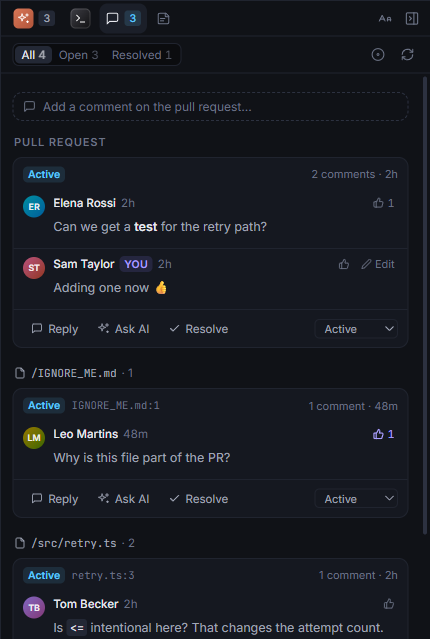
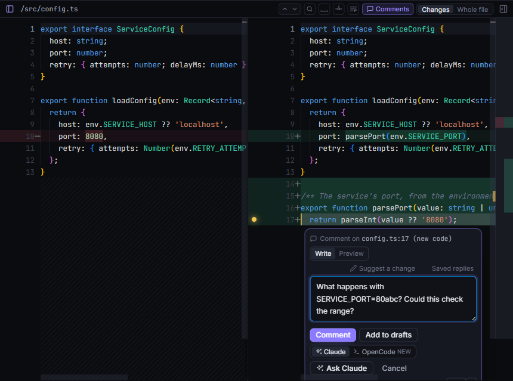

# Comments

## The PR's threads

The **Comments** tab of the panel lists every thread on the PR, yours included: who said what, the replies, and the thread's status. Click a thread's `file:line` to see its lines in the diff.

From here you can:

- **reply** to a thread;
- **resolve** it, or reactivate it (on Azure DevOps there are other statuses too, such as won't fix);
- **edit** your own comments;
- write a **new comment** on the PR.

Each of these shows a confirmation with exactly what will change before anything is posted. Or keep your comments and replies in your drafts and post them together: see [Drafts](#drafts).

**Ask AI** on a thread asks an agent about it. See [Asking the agent](ask.md#about-a-comment-thread).

## Threads in the diff

Threads also show in the diff, under their lines, the way Azure DevOps shows them. You can reply, resolve and edit there too. The **Comments** toggle above the diff hides them.

While the Comments tab is open beside the diff, the diff only marks the threads' lines with a speech bubble in the margin; click it to pick that thread in the tab.

On GitHub, a thread on code that has changed since shows with its file, not on a line of the new version. Azure DevOps moves threads along with the code where it can; one it can't place stays at its original lines.

## Comment on code

1. Hover over a line in the diff and click the **+** in the margin.
   For several lines, select them and click the **+** on one of them, or press <kbd>C</kbd>. It's in the right-click menu too.
2. Write the comment.
3. Post it, and confirm. The comment lands on the same lines in Azure DevOps or GitHub.

You can comment on new code and, side by side, on deleted lines. Lines you pick on the old side that the PR didn't change go on the new code, at their new line numbers.

Or click **Add to drafts** to post it later, with your other comments: see [Drafts](#drafts).

The comment box's **Ask** button (**Ask Claude**, say) sends your text to the agent as a question instead. See [Ask about some lines](how-to/ask-about-lines.md).

## Writing a comment

Every comment and reply box takes Markdown:

- **Preview**, above the box, shows it as it will look; **Write** goes back.
- Type **@** and the start of a name to mention someone on the PR: its author, reviewers and the people in its threads. Pick one with <kbd>Tab</kbd> (or <kbd>↑</kbd> <kbd>↓</kbd> first), or click it. Azure DevOps writes a mention as the person's id, so the box shows who it is underneath; Preview shows the name.
- **Saved replies** puts one of your saved replies in the box. To save one, write it, then **Saved replies** → **Save this as a reply**. **Manage…** (or <kbd>Ctrl</kbd>+<kbd>K</kbd> → "Saved replies…") renames, reorders and deletes them. You can keep 50.

<kbd>Ctrl</kbd>+<kbd>Enter</kbd> posts (after the confirmation, as always) and <kbd>Esc</kbd> cancels.

## Drafts

Going through a PR, you often want to write all your comments first and post them in one go. **Add to drafts**, in the comment box and in a thread's reply box, keeps a comment or reply for later instead of posting it. Nothing goes to Azure DevOps or GitHub yet.

- Your drafts are at the top of the **Comments** tab, where you can edit or delete them. Click a draft's place to see its lines.
- In the diff, a draft's line has an amber speech bubble.
- The PR's header says how many you have: **2 drafts · Post…**.

**Post…** (in the header or above your drafts) opens the Post dialog. It lists your drafts, ticked, above the review's kept comments, with the summary and the vote. One **Post** sends them all, and the dialog shows exactly what that is first. Posted drafts leave the list; one that fails stays, with why.

Your drafts are kept on this computer, per PR, until you post or delete them.
