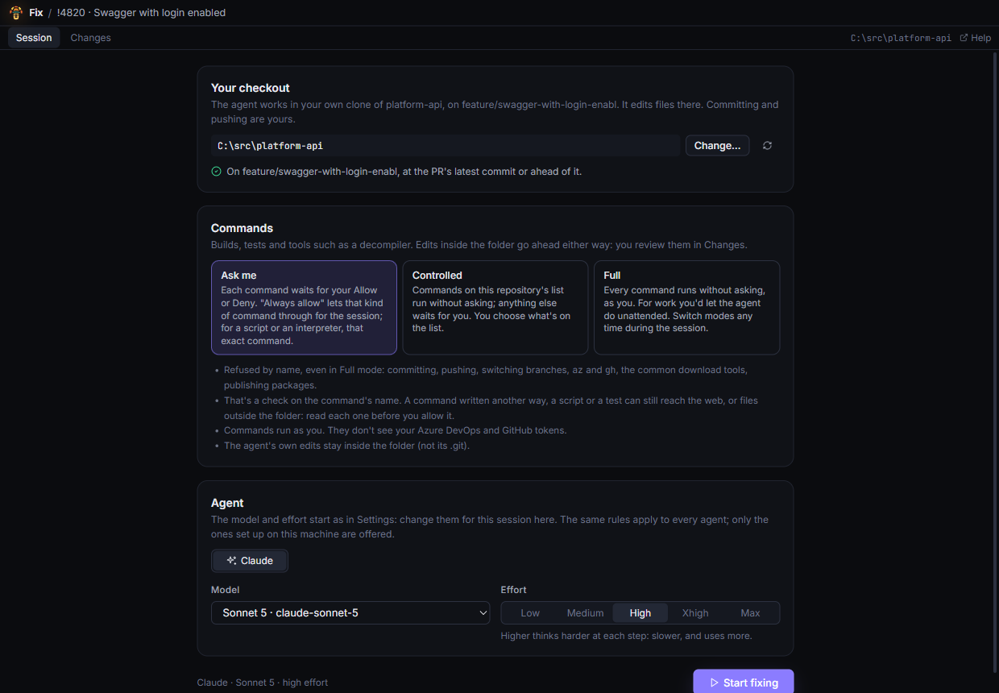
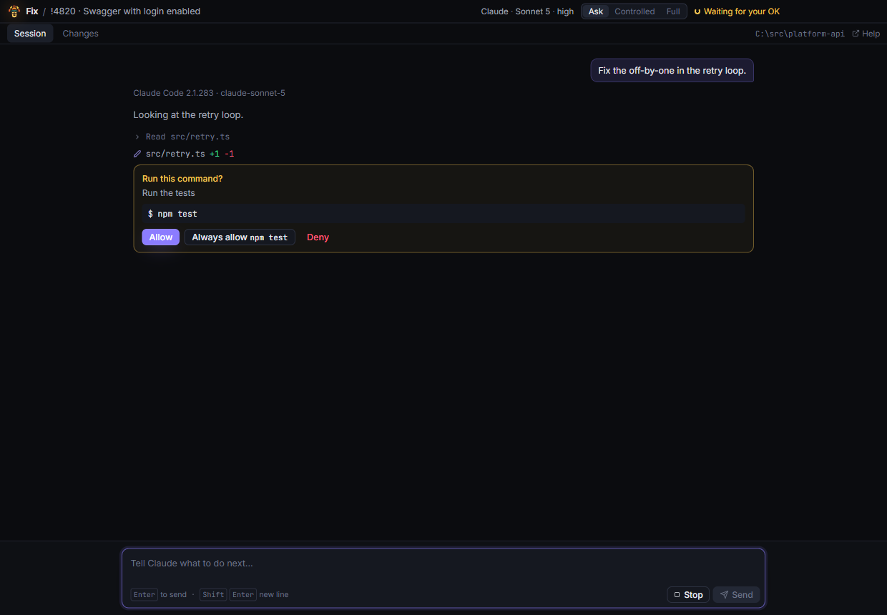
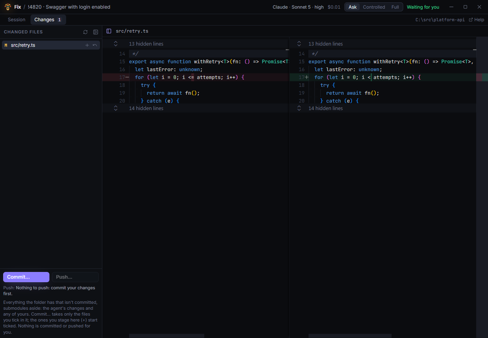

# Fix mode

For your own PRs: an agent fixes what the review found, or what a reviewer asked for, in **your own clone** of the repository. You see every change, and you commit and push when you're happy.

**Fix…** is in the header of PRs you created. It opens a window of its own. **Help**, in that window, opens this page.

## Set it up

1. **Link your checkout…**: pick the folder of your clone. You do this once for each repository (the same link is used to [review a branch before its PR](reviews.md#review-a-branch-before-its-pr)).
   The app checks that the folder is a clone of the PR's repository, on the PR's branch, with its latest commit (commits of yours that aren't pushed yet are fine). If files have uncommitted changes, it says so, and **Start fixing** waits until you tick **Start anyway**: the agent's changes would mix with yours.
2. Pick the **agent** (Claude, Copilot or OpenCode, among those set up on this machine), its **model** and **effort** for this session. They start as in Settings.
3. Pick how commands are approved:
   - **Ask me**: each command waits for your OK.
   - **Auto**: commands run without asking. You can switch this on or off at any time in the session. The first time you pick it, the window explains what it means and asks you to confirm; **Keep asking** stays on Ask.
4. **Start fixing**.

## Tell it what to fix

Write in the box at the bottom, like a chat: "fix the findings", "do what Tom asked in the comments", "the off-by-one in retry.ts". The agent knows the PR, the reviews' findings still to fix and the open comment threads.

When the agent says it fixed findings, they're marked **Fixed** in their review, and the session says which. You can take a mark back on the finding in the main window. A re-review after you push checks them.

- **Edits** to files in your folder go ahead.
- **Commands** (a build, the tests, a code generator) wait for **Allow** or **Deny**. **Always allow** lets that kind of command through for the rest of the session: the program and its subcommand, such as `dotnet test`. For a command like `node build.js` or `python script.py`, that's every later `node` or `python` command. In **Auto** mode, commands run without asking. Commands the agent's own tools consider read-only, such as listing files, run without asking, marked "read-only".
- **Blocked**, even in Auto mode:
  - git commands that change anything: committing, pushing, switching branches, `add`, `stash`, `reset` and the like (reading, such as `git diff` or `git log`, is fine);
  - the Azure and GitHub command-line tools (`az`, `gh`);
  - the common download and remote-connection tools (`curl`, `ssh`, …);
  - publishing packages (`npm publish`, say).

  The app recognizes these by the program a command starts. It doesn't stop everything that could do the same: a script, a test or another program can still reach the web, run git, or read and change files outside your folder. Allowing a build or the tests also runs code the agent may just have changed. Commands run as you, with your access, though they don't see your Azure DevOps and GitHub tokens (nor, with Claude, the key it signs in with). That's why they ask first: read each one before you allow it. Turn on **Auto** only for work where you'd let the agent run commands on your computer unattended.

Scrolled up? The button at the bottom (or <kbd>End</kbd>) goes back to the latest message.

## Commit and push

The **Changes** tab shows what changed in your folder, file by file, and which changes are staged. <kbd>F</kbd> hides the list of files, and you can drag its edge to resize it. Point at a file for what you can do with it:

- **Unstage** takes a staged change out of git's index. The change stays.
- **Discard…** undoes the file's changes, after you confirm: it goes back to its last commit, or, if it's new, it's deleted.
- **Keep out of git** is for a file git doesn't know that you never want to commit, such as a local settings file. It's listed in the folder's `.git/info/exclude`, on this machine only, and stops showing as a change. The file stays.

Then:

- **Commit…**: pick the files. What the agent changed in this session is picked at first. Files that were already changed before the session started aren't, and say so: tick them if you want them in. A message is suggested, and you can change it.
- **Push…**: shows the commits and files that will be pushed, and pushes after you confirm. It never force-pushes. When there's nothing to push yet, the tab says why under the buttons.

Both wait while the agent is working. The agent is refused `git commit` and `git push`: you commit and push, with these buttons. **Commit…** runs your repository's git hooks, so if the agent changed a hook script your repository keeps (in `.husky`, say), look at that change before you commit.

## Check the fixes

After a push, **Re-review the changes** reviews what changed since the review, and checks whether the findings are fixed. The agent that reviewed the PR does it: the fixing agent if it did, with the session's model and effort; otherwise the agent that did, with its own model and the session's effort. The button's tooltip says which. The re-review shows in the main window, with the open comment threads the push looks to address: tick the ones to resolve, change the reply if you like, and **Resolve** them together after one confirmation.

See [Fix your own PR](how-to/fix-your-own-pr.md) for a walk-through.
