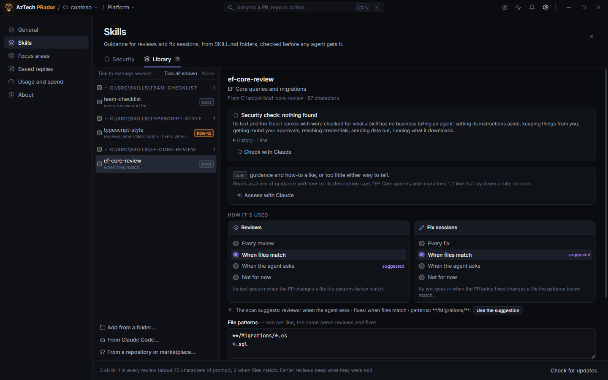

# Give reviews a skill

A **skill** is a folder with a `SKILL.md`: a name and a one-line description at the top, then instructions in Markdown. It's the format Claude Code, GitHub Copilot and OpenCode share, so a skill you have for any of them works here, and so does one you write yourself: a checklist for your framework, the way your team handles migrations, what to look for in a controller.

**Skills**, a section of Settings (the gear in the title bar, then **Skills** in its side nav; <kbd>Ctrl</kbd>+<kbd>K</kbd> → **Skills…**; or the pencil by the skill chips), is the app's library of them: a **Library** tab for the skills and how each is used, a [**Security** tab](#the-security-tab) for what the check found and what needs you. <kbd>Esc</kbd> closes Settings. The list's edge drags to widen it (double-click puts the default back).

 Reviews by Claude, Copilot and OpenCode alike get the ones that apply: in their prompt, after the repository's guidelines and your instructions, or, for the ones you set to **when the agent asks**, as a line each and a tool the agent reads them with when the change calls for one. [Fix sessions](#in-fix-mode) get them too, with a setting of their own per skill, since a how-to for building is worth more to an agent editing code than to one judging a diff. The app [reads each skill as it comes in](#what-a-skill-reads-as) to tell which is which, and [checks it](#the-security-check) for what a skill has no business telling an agent.

## Add a skill

- **Add from a folder…**: pick the skill's folder (the one holding `SKILL.md`), or a folder of skills: each in a folder of its own, or under a `skills` folder, as a plugin keeps them.
- **From Claude Code…**: what Claude Code has on this computer: your own skills, those synced from your claude.ai account, and the skills of its installed plugins (a plugin not enabled in Claude Code counts too), grouped by plugin.
- **From a repository or marketplace…**: a repository of skills, a plugin, or a marketplace's catalog, fetched to pick from. Type it as `owner/repo` (on GitHub), an https link (a GitHub `/tree/<branch>` link works), or a folder on this computer; `#branch` at the end picks a branch or tag. The marketplaces Claude Code knows are listed below the box, read from its own copies: a plugin a marketplace keeps in another repository is fetched when you ask for its skills (**Show its skills**). A private GitHub repository works when the GitHub CLI is signed in to its host.

In each picker the skills are grouped by plugin, with a box per plugin to tick them all and a chevron to fold it (a catalog of many plugins starts folded; **Collapse all** and **Expand all** do them at once); the box above filters by name, description or plugin and shows what matches whatever is folded, **Tick all shown** and **Untick all shown** take what the filter leaves, and ticks are kept while you filter. A tick means in the library: a skill already in is ticked, and unticking it takes it out of the library when you apply (after a confirmation); the count line and the button say what will happen ("2 to add · 3 to remove"). Each skill carries a tag saying [what it reads as](#what-a-skill-reads-as), and the footer counts them ("12 how-to, 4 for reviews"). Under a skill, a line says what the [security check](#the-security-check) found: one it refuses can't be ticked, and says why; one with warnings says how many, and goes in held back. **In reviews** and **In fixes** say how what you add is used, each starting as **as the scan suggests**: a checklist goes into reviews when the files it names change, a how-to goes to fix sessions and stays out of reviews or waits for the agent to ask, a page of commands stays out of reviews. Pick a way for all instead (**every review**, **when files match**, which asks for the patterns every skill added gets, **when the agent asks**, or **not for now**) when you know better; change any skill afterwards. Adding ends on a report: the skills that go to reviews and fix sessions as set, the ones held back for warnings to accept (each listed with its warnings and an **Accept**), and the ones refused, with why; **Done** shows the first skill added, **Back to the picker** goes on picking. The library's own list is grouped by where skills came from, with a filter box once it holds a few. The box has the cursor when the dialog opens; while it filters, a line above the list says so (**Showing 5 of 23**) with **Show all**, and its **✕** (or <kbd>Esc</kbd>) empties it.

Either way the skill is **copied** into the library, with the text files next to it. Where it came from is left as it is, and changing it there changes nothing here until you update: **Check for updates** at the bottom asks each repository where its branch is now (without fetching it) and compares each folder's file with your copy, then marks the skills that moved on; **Update all** reads them again in one go, one fetch per repository, and says which got new text. One skill at a time: **Read it again** (a folder) or **Fetch it again** (a repository, at the branch it was fetched from). Updating keeps how you use a skill. Read a skill's text in the dialog before a review gets it: it goes into the agents' prompts as written.

## The security check

Before a skill goes in, the app checks its `SKILL.md` and every file it comes with, line by line, for what a skill has no business telling an agent. Like the scan, it works from the text alone: nothing is sent anywhere, and each finding says which file and line it's about, and why.

Some findings refuse a skill: it can't be ticked, and the line under it says why.

- Telling the agent to set its instructions aside, or posing as part of the app's prompt (a `</skill>` or `<system>` tag, a conversation written out as **Human:** and **Assistant:**).
- Telling it to keep something from you, or to get round your approvals (switching to Full, clicking **Always allow**).
- Downloading something and running it (`curl … | bash`, `iwr … | iex`), or running a command hidden in an encoding.
- Reading, copying or sending where credentials are kept (SSH keys, token caches, the app's own folder), or printing the environment variables.
- A request bin, a tunnel, a paste site or a chat webhook; a picture whose address carries data, which a comment on a PR would send out as soon as someone looks at it.
- Hidden characters (zero-width or bidirectional ones), which can hide instructions from a reader.

Others are warnings: the skill goes in **held back**, and no review or fix session gets it until you've read them and accepted them.

- A script among its files: nothing in the app runs it, but an agent in a fix session could be told to copy it into your checkout and run it.
- Changes beyond the checkout: scheduled tasks, what starts with Windows, shell profiles, global git settings, trusted certificates, package sources.
- Deleting more than the work: a drive, your home folder, history on the server.
- Showing or sending a credential by name, telling the agent not to report something (security findings, secrets), asking it for its prompt.
- Text you don't see when it's shown formatted (an HTML comment, hidden markup), a long encoded blob, a word that mixes alphabets.
- What would refuse a skill, but quoted as an example ("ignore previous instructions", in a skill about prompt injection), and an installer from a toolchain's own site piped to a shell (.NET's `dotnet-install.sh`).

A skill held back has a shield in the library's list and says **held back: warnings to accept**. Its pane lists each warning with the line it's about (**Where** shows the lines around it, in the skill's copy): read them, and the skill's text further down, then **Accept the warnings**; **Hold it back again** takes that back. Tick several to accept theirs together, after a confirmation saying how many. A skill read again keeps the warnings you accepted, and a new one holds it back again, marked **new**; one refused when read again keeps the copy you had. What a review or a fix session gets is what was checked: if a skill's copy in the library changes afterwards, the session goes without it until you read it again. Skills already in your library are checked once, the first time the app reads it. A review's log, and a fix session's transcript, say which skills were held back or refused.

For a closer read, **Check with Claude** (or Copilot, or OpenCode: the same choice as for **Assess**) in a skill's security box, or on all the ticked ones, has the agent read the skill and every file it comes with, in the library's folder, for the same things however they're worded. What it finds is listed with the app's own findings, marked with the agent's name, and counts the same way: a warning holds the skill back until you accept it, something worse refuses it. It adds to the app's check and never takes from it, so a skill the app refused stays refused whatever the agent says. **Check again** replaces its earlier answer, and a skill read again with changed files goes without it. What the agent spends counts in Usage and spend.

The checks catch what such text usually looks like, and a skill can be written to slip past them: read a skill before you give it to an agent.

## The Security tab

The gear in the title bar, and **Skills** in Settings' side nav, count the skills that need you (held back for warnings, or refused), and Skills opens on its **Security** tab while any does. The tab starts with where the library stands: how many skills had nothing found, have warnings you accepted, are held back, refused, or not checked (a copy that couldn't be read), and a line on how the check is made. **Check 5 with Claude** (or Copilot, or OpenCode) has the agent read every skill it hasn't checked yet; once it has them all, **Check all again**.

**To act on** lists the skills that need you, first. One held back shows its warnings with the line each is about; **Where** opens the lines around it in the skill's copy, the finding's own marked (a copy changed since the check says so). **Accept the warning** lets the skill through from there, **Open in the library** shows it in the Library tab with its text, **Remove** takes it out. A refused skill shows what refuses it, with **Remove**; one whose copy couldn't be read offers **Read it again**. With several held back, **Accept the warnings of all…** does them together, after a confirmation. When nothing needs you, the tab says so.

**Every finding** in the library follows: grouped **By reason** (what refuses a skill first, then the most found) or **By skill**, filtered by the box (a skill's name, the reason, the file or the line), and narrowed to **To accept**, **Accepted** or **Refusing**. Each says where it stands, which agent found it when one did, and has **Where**; the skill's name opens it in the Library tab at that finding, lit for a moment with its lines shown.

In the Library tab, a skill's security box has the same findings with **Where** on each, and its **History**: when it was added and read again, what each check found, the warnings you accepted or held back again, an agent's check.

## When a review, or a fix, gets it

**How it's used**, in a skill's pane, is two cards side by side, **Reviews** and **Fix sessions**, each with the same four ways; the chosen one is explained under the card, and the way the scan, or an agent's assessment, suggests is marked *suggested*:

- **Every review** (or every fix): its text goes into every prompt, whatever the PR changes.
- **When files match**: file patterns, in the box under both cards once either card says so, one per line, the same for reviews and fixes. `*` is anything within a name, `**` anything across folders, `?` one character. A pattern without a `/` matches a file's name wherever the file is (`*.cs`, `appsettings*.json`); with one, the whole path from the repository's root (`src/Api/**`, `**/Migrations/*.cs`). A trailing `/` is that folder and everything in it. Case doesn't matter.
- **When the agent asks**: the prompt has only the skill's name and what it's for, one line, and the agent has a tool that gives it the skill's text, or one of the files it comes with, when it judges the change touches what the skill is about. The line says what kind of page it is (a reviewer's checklist, a how-to, tools), and a listed skill whose file patterns match the PR's files goes first, marked to read before judging those files; the review card says how many matched, and names a matching one the agent didn't read. The setting for a plugin's many skills: a review of a controller doesn't carry the actor checklist, and the agent opens it when the PR changes an actor.
- **Not for now**: kept in the library, given to no review (or no fix).

The row in the library says how a skill is used; when reviews and fixes differ, it says both ("reviews: not for now · fixes: when the agent asks"). A how-to usually wants exactly that: out of reviews, where an agent that writes no code has little use for it, and on request in fixes.

## What a skill reads as

The app reads every skill's text as it comes in (and the ones already in the library, once) and tags it with what it reads as, from its words and counts alone, nothing sent anywhere:

- **for reviews**: guidance for reviewing, with rules to check and pitfalls to look for.
- **how-to**: a how-to for building, with what to write and how; better for fixes than reviews.
- **commands**: a page of commands to run, which a review can run nothing of and a fix can.
- **both**: guidance and how-to alike, or too little either way to tell.

The tag's tooltip, and the skill's pane, say why: what the skill says it's for, how many reviewing or building words it uses, how many lines lay down a rule, how many code blocks and commands it holds. A line under the cards says what the scan suggests (how to use it in reviews and in fixes, and the file patterns it names, such as a Migrations folder or `*.sql`); **Use the suggestion** takes it. A language's extension alone (`*.cs`, `*.ts`) is kept as information, not used as a pattern: it would match nearly every PR of the repository, so a skill about all code of a language is suggested **when the agent asks** instead, and the suggestion line says so. The scan is quick and honest about being quick: it sorts a plugin's forty skills, it doesn't read them.

For a closer read, **Assess with Claude** (or Copilot, or OpenCode: the agent reviews start with, or the one you pick beside the button among those set up here) has the agent read the skill, or all the ticked ones at once, in the library's folder, and say how much of it a review and a fix can use (from nothing to all), why, which files it's about, and, for reviewers, what to check in one line. That line is what a review's listing says about the skill from then on, instead of the skill's own description, which for a how-to starts with "Write…" and gives a reviewer no reason to open it. **Use it** sets both uses from the scores. What the agent spends counts in Usage and spend; its session is thrown away. An assessment stays with the skill until its text changes.

## Several at once

The library's list has a box per skill, and one per source (a plugin, a folder): tick some, and the pane on the right manages them together. It says what they read as ("12 how-to, 4 for reviews"); **Use the scan's suggestion for all** sets each as its scan suggests, and **Assess with …** has the agent read them all. The same two cards set how all of them are used in reviews and in fix sessions, each saying when the ticked ones differ (patterns typed under them replace each one's own; left empty, each keeps its own); **Read them again from where they came** fetches or reads them all again; **Remove them from the library** takes them all out, after a confirmation naming how many. **Tick all shown** takes what the filter leaves, **None** clears the ticks, and the **N ticked** button brings the pane back after you've looked at a single skill. Ticks stay while you filter: skills ticked that the filter hides are counted (**5 ticked, 2 not shown**), and the pane still changes them. The quickest way to tame a plugin's forty skills: tick its box, **Use the scan's suggestion for all**.

## For one review

A review's start screen (and the **Using …** options) shows the skills that apply to the PR, each in the review unless you click it off; **None this time** leaves them all out of this one review, and the last button opens the library. A few skills are a row of chips. More are a summary line and a line per source (a plugin, a folder), each with a box for the lot and a count; **Choose…** opens a dialog to pick them one by one, with a filter, **All of them** and **None this time**. That choice is for this PR's next review only: the library's settings stay as they are. The **Using …** line counts what the review gets ("1/3 skills", "no skills"), the ones for the agent to ask for included, and the finished review shows the skills it was given: **N on request** for those, and, marked with an eye, each one the agent read.

A review's log says which skills it got (**Skills: …**), which the agent could read (**Skills the agent can read when it needs them: …**) and which it read (**Read skill …**), which you left out, and which didn't fit. The review keeps what it was told: changing or removing a skill later changes nothing for reviews already done, nor for their follow-up questions.

## In fix mode

A [fix session](fix-your-own-pr.md) gets the skills whose **Fix sessions** setting applies to the PR, chosen the same way as a review's: the start screen of the fix window has a **Skills** section with the ones that apply, the chips or lines per source, **Choose…** and **None this time**, and the line beside **Start fixing** says when you've left some out ("2/5 skills"). The title bar of a running session counts its skills and how many the agent has read; the tooltip names them. The transcript says which skills the session got (**Skills: …**), which the agent can read (**Skills the agent can read when it needs them: …**), and each one it reads (**Read skill …**). The wording the agent gets fits the work: the skills are yours, the author's, for what you ask it to do, and the ones for it to ask for are offered when what it's changing touches them. A skill that says to run something doesn't run it: a command the agent decides to run still goes through Ask, Controlled or Full, like any other. A session given a skill whose [warnings](#the-security-check) you accepted has **Full** off, and the transcript says so: whatever the skill leads the agent to run asks you, or is on the repository's list in Controlled. Skills written for building things (how to configure a library, how to write a test) tend to be used more in a fix than in a review, where only the ones about what to look for tend to be read.

## What the agent does with it

A skill's instructions are guidance, added to the review's (or the fix's) own rules; they can't relax them. Nothing in a skill is run by the skill tool: a review has no shell, so a skill that says to run a script or a tool is read, not executed, and in a fix session a command the agent takes from a skill asks you as any other does. The other text files a skill comes with (a reference, a longer checklist) are named to the agent with it, and it reads one with the same tool when it needs it, whether the skill is in the prompt or on request. The tool reads the library's copies only: nothing from the PR's checkout or your folder, and nothing outside the skill's folder.

Long skills are cut: a review takes up to 24,000 characters of each, and 60,000 of all its skills together (the log says when one was left out). A skill that goes into every review costs context on every review, so keep those few and short, give the rest file patterns, or leave them for the agent to ask for. When the skills set to every review add up to more than a review takes together, the summary line at the bottom of the dialog says so. Follow-up questions have the same list and the same tool.
