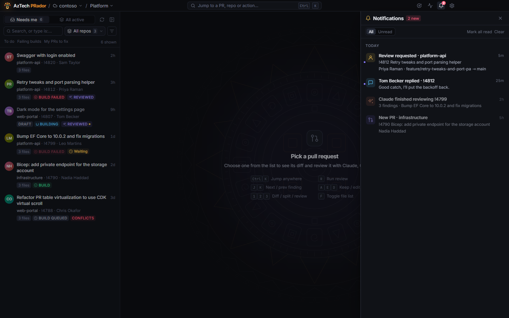

# Notifications

## The bell

The bell in the title bar lists what happened while you were busy. Click one to go to its PR, or straight to the thread.

You're told when:

- you're added as a reviewer on a PR, in any repository (not when your own vote put you among its reviewers);
- a PR is opened in a repository you **watch**;
- someone replies in a thread you commented in;
- someone else resolves a thread you commented in;
- an automatic review has finished;
- a review you started finishes, or fails, while its PR isn't on screen;
- something happens on one of **your own PRs**: a reviewer votes, someone starts a comment thread, it gets merge conflicts, a required check fails, or it's completed or abandoned;
- a **usage limit** passes your level (80% to begin with), and when it's used up: Copilot's monthly allowance, or GitHub's or Azure DevOps' budget. Once each time it starts again. Click it for Usage and spend, which shows them all.

Settings → Notifications has a switch for each of the first four, **News about my own pull requests**, and **A usage limit passes** with its level. Each also shows as a Windows notification while the app is running, including from the tray.

Going to a PR yourself counts as seeing what it was about: its notifications are marked read in the bell, and their Windows notifications leave Windows' notification centre. A reply or a resolved thread counts once the PR's **Comments** tab is showing. A PR left open while you're in another app doesn't count until you come back to it.

Acting on a PR in the app counts too: a vote, a comment or a reply, completing or abandoning it (merging or closing, on GitHub). Its notifications are read from then, even once it's gone from the list. And you're not told about what you did yourself: completing or abandoning your own PR doesn't bring a notification that it was completed or abandoned.

**Send test notification** in Settings checks they get through. If you don't see it, check Windows Settings → System → Notifications, and Do not disturb.

Drafts: new drafts aren't announced unless you turn on **Include new drafts**. Otherwise you're told when a draft is published.

## Watch a repository

Open the repository menu above the PR list (it says **All repos** until you pick one) and click the bell next to a repository. New PRs in it are announced. Watched repositories are listed in Settings → Notifications, and remembered per project. See [Get notified about new PRs in a repo](how-to/watch-a-repo.md).

## Automatic reviews

Turn on **Automatically review new PRs with your default reviewer** in Settings → Notifications. It needs **New pull requests in watched repositories** on. New PRs in watched repositories are then reviewed as they arrive, in the background, and the notification tells you when the findings are ready.

Automatic reviews use your default agent, model, effort, focus and budget cap. A draft that was reviewed and is then published gets a review of just what changed.

### Re-review after a push

Turn on **Re-review a PR after its author pushes**, below it, and a PR you've reviewed gets a review of what's new once the author stops pushing for 10 minutes. It's done by the agent that reviewed the PR, picks up your earlier decisions, and marks the findings the push fixed as resolved. The notification says how it went: **Re-review after a push**, with how many findings were fixed, how many are new and what's still open. It covers PRs you're a reviewer on and PRs in watched repositories, and it works without automatic reviews of new PRs.

### A daily limit

**At most … automatic reviews a day** (20 to begin with) caps both kinds together, so a busy day can't run up a bill. Once it's reached, the bell says so, and they start again the next day. 0 means no limit.

They only produce findings. **Nothing is posted**: you go through them and post as usual.

## A summary of your day

Turn on **A summary of my day** in Settings → Notifications and pick the hour (9:00 to begin with). Once a day, the first time the app runs after that hour (or when you unlock your computer), the bell and a Windows notification sum up what waits for you: how many PRs wait for your review and how old the oldest is, your own open PRs (and how many have conflicts), and what's unread. Click it in the bell to see the PRs that need you. It's off to begin with, and says nothing on a day with nothing to say.

## The tray

When you close the window, the app keeps running in the system tray, so notifications keep coming. The tray icon gets a dot when some are unread; hover over it for how many. To quit, right-click the tray icon → **Quit AzTech PRador**. To quit when you close the window instead, turn off **Keep AzTech PRador running in the system tray when the window is closed**, in Settings → **General**, under **Refresh and budget**.

**Start AzTech PRador in the tray when Windows starts**, next to it, starts it when you sign in to Windows, so you're told about PRs from the start of the day.
