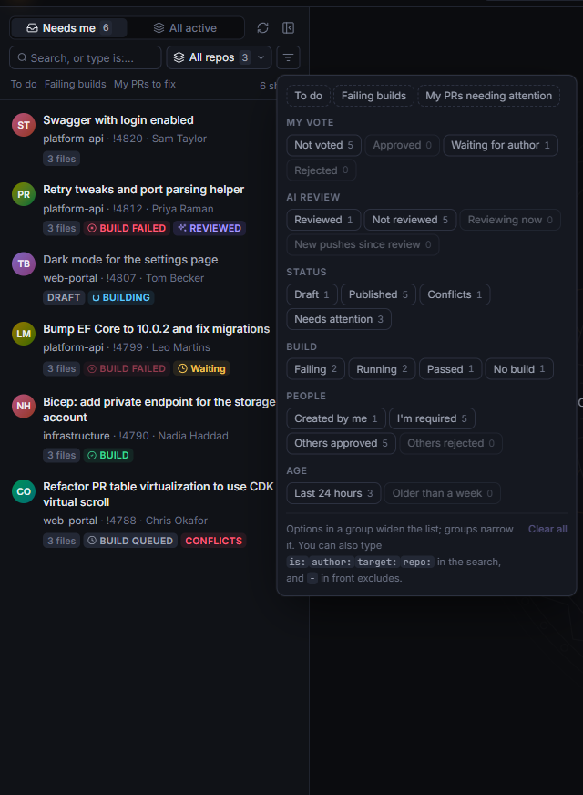
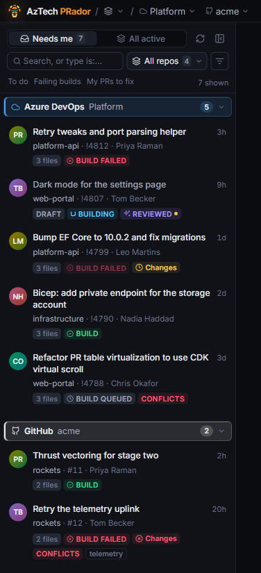
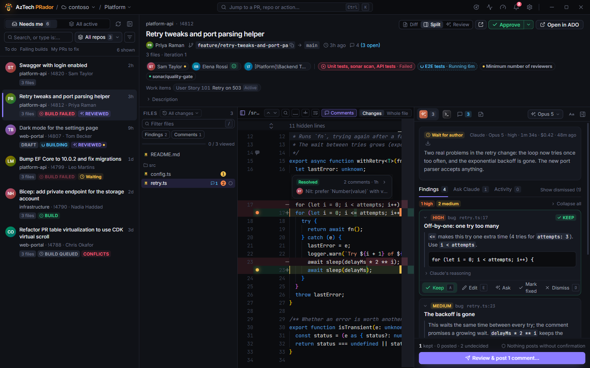

# Pull requests

## The list

The list on the left has two tabs:

- **Needs me**: PRs where you're a reviewer, whether you've voted yet or not. On GitHub: PRs asking for your review, plus the ones you've reviewed.
- **All active**: every active PR, drafts included, in all the project's repositories or the one you pick in the repository menu above the list (it says **All repos** until you pick one).

The tab you're on and the repository you picked are kept when you restart the app. Each project keeps its own repository pick.

Each row shows the title, repository, author, how long ago it was opened, a **Draft** badge, how many files it changes (amber from 50: a big PR; on GitHub, hover over it for the lines added and deleted), your vote, and the PR's builds (failed, building, queued or passed; dimmed when they ran on an earlier version). A **Reviewing** badge means an agent is on it now; **Reviewed** means it's been reviewed, with a dot when the author has pushed since.

<kbd>Ctrl</kbd>+<kbd>B</kbd> collapses the list to a narrow rail that still marks failed and running builds. Drag the list's right edge to make it wider or narrower (double-click the edge for the default width).

### Filters

The filter button next to the repository menu filters by:

- **your vote**: not voted, approved, waiting, rejected;
- **AI review**: reviewed, not reviewed, new pushes since the review;
- **status**: draft, published, conflicts, needs attention;
- **build**: failing, running, passed, none;
- **people**: created by me, I'm required, others approved or rejected;
- **age** and **target branch**.

Each option shows how many PRs it matches. Options in one group add to the list, and groups narrow it. <kbd>Alt</kbd>+click an option to leave those PRs out instead. The presets **To do**, **Failing builds** and **My PRs needing attention** are a click away, in the menu and in the row under the search box (where the last one is **My PRs to fix**).

You can type the same filters in the search box, with suggestions as you go:

| Type | To see |
|---|---|
| `is:unvoted` | PRs you haven't voted on |
| `is:failing` | PRs with a failing build |
| `author:me` | your PRs |
| `author:"Priya Raman"` | someone else's |
| `target:release/*` | PRs into a release branch |
| `repo:api` | PRs in repositories with "api" in the name |
| `label:needs-qa` | PRs with that label (on Azure DevOps, a tag); `label:team-*` for any starting so |
| `-is:draft` | a `-` in front leaves them out |

Each tab keeps its own filters, and they're remembered when you restart. When the filters hide every PR, the list says how many are hidden and offers **Clear filters**.

A PR's **labels** (Azure DevOps calls them tags) show on its row, the first three, and in its header. Click one in the header to list the PRs that have it. Words you type in the search box find labels too.

### Staying up to date

A long list (a big GitHub organization's, say) shows its newest PRs first, with **Loading more PRs…** under them while the rest come; builds appear on the rows as they're read.

The list is re-read every minute. You can change that with **Auto-refresh PR list** near the bottom of Settings, or turn it off (0). Builds come with it every few minutes, and more often while one is queued or running.

When the PR you have open changes, it updates in place: title, description, votes, builds and comments. New commits bring the diff along, with the same file open at the same place. If you're typing a comment in the diff, the new commits wait: the header says **New commits · Show them**.

The app also catches up when your machine wakes, when the network comes back, and when you come back to the window. <kbd>F5</kbd> refreshes now.

## Projects and organizations

Click the project's name in the title bar (or <kbd>Ctrl</kbd>+<kbd>K</kbd> → "Switch project…") to pick another project in your organization. Recent ones come first, and you can type to search. The list, repositories and notifications follow the project you pick.

## Azure DevOps and GitHub

The title bar switches between Azure DevOps and GitHub. You land where you last were on each. The first time on GitHub, you pick an organization (or your own account).

### Both at once

Once you have an Azure DevOps project and a GitHub organization, pick **Azure DevOps and GitHub** in the same menu: the list shows both, each in a section of its own under a header in its provider's colour (blue for Azure DevOps, grey for GitHub), Azure DevOps on top. A section's header stays at the top while you scroll through its PRs. The small reload button at the end of a header reads just that provider's PRs again; the refresh button at the top reads both. Each section has its count, and folds away when you click its header (it stays folded until you open it again). The title bar shows where each side's PRs come from, with a switcher for each (the provider menu before them shows just its icon then).

**Needs me**, **All active**, the filters and the search work across both, and the repository menu groups the repositories under each side. A PR you open uses its own provider's words and votes. Notifications and the morning summary cover both sides. When one side can't be read (signed out, say), its section says why, and the other one still shows. Pick **Azure DevOps** or **GitHub** in the menu to go back to one of them.

Everything works the same on both, with GitHub's words for things:

- Votes are GitHub's reviews: approve, or request changes. GitHub doesn't let you review your own PR, so you can't vote on it.
- Builds are GitHub's checks (check runs and commit statuses), with the required ones marked.
- A review's comments go on the PR as one GitHub review.
- PRs are numbered `#42` rather than `!42`.

The app uses your GitHub CLI sign-in (`gh auth login`). For GitHub Enterprise, set the host in Settings → GitHub.

## A pull request

### The header

The header has the PR's title, branches, author and reviewers with their votes, and its builds.

- Click the **source branch** to copy its name.
- Click a **build** to see its pipeline run: where it stopped, its first errors, and a link to it.
- **Approve** votes on the PR. The menu next to it has the other votes: approve with suggestions, wait for author, reject, or reset your vote (on GitHub: request changes). Every vote shows a confirmation first.
- The **layout** buttons switch between **Diff**, **Split** and **Review** (<kbd>1</kbd>, <kbd>2</kbd>, <kbd>3</kbd>): the diff alone, the diff and the panel side by side, or the panel alone. In **Split**, drag the panel's left edge to make it wider or narrower (double-click it for the default width).
- **Open in ADO** (or **Open in GitHub**) opens the PR in your browser.
- On **your own PRs**: **Complete…** (**Merge…** on GitHub) merges it. Pick the merge type (it starts on the default you set for each provider in **Settings**: **Squash commit** on Azure DevOps and **Create a merge commit** on GitHub until you change them) and the commit message, and whether the source branch is deleted and (Azure DevOps) the linked work items move on. The dialog lists the required checks that haven't passed yet; Azure DevOps may refuse to complete until they do. The menu next to it has **Set auto-complete…** (**Merge when ready…** on GitHub: it merges on its own once the checks pass), **Publish** for a draft, and **Abandon…** (**Close…**). Each asks before it does anything. Completing, setting auto-complete and abandoning ask once more, in a small window of their own (it says **Asked again by the app itself**): the change happens only when you confirm there too. **Write the description…**, in the same menu, has an agent write the PR's description from its changes (and its work items): edit it, then **Update the description…** replaces the current one, after a confirmation that shows it.

### The diff

The diff shows the old and new versions side by side. <kbd>W</kbd> switches between only the changes and the whole file. <kbd>F</kbd> shows or hides the file list.

The buttons above it:

- The arrows (or <kbd>N</kbd> and <kbd>P</kbd>) go to the next and previous change in the file.
- The magnifier (or <kbd>Ctrl</kbd>+<kbd>F</kbd>) finds text in the file.
- **Hide whitespace changes** leaves out changes to the spaces at the start and end of lines, so re-indented code shows as unchanged.
- **Wrap long lines** wraps them instead of scrolling sideways.
- **Blame** shows, on the line under the mouse, who last changed it, when, and the first line of that commit's message, on either side.

The last three stay as you leave them.

**Go to definition**: put the cursor on a name in the diff and press <kbd>F12</kbd> (or <kbd>Ctrl</kbd>+click it). Where it's defined in a file the PR changes, the diff goes there. Anywhere else, the file opens in place, under the line, and <kbd>Esc</kbd> closes it. When there are several candidates, it lists them. The app finds definitions by searching the code at that version for the shapes they take (`class`, `function`, `def`, a method…), in files of the same language: a good guess, not a compiler's answer.

Blame and Go to definition read the app's own copy of the repository, the one reviews use. The first time for a repository, it's copied first, which can take a while.

**Filter the files** with the box at the top of the file list, or press <kbd>/</kbd> from anywhere:

- Words match anywhere in the path, and every word has to match.
- `*.cs` matches file names, and `Migrations/*` or `tests/**` match folders.
- A `-` in front leaves files out: `-test -package-lock.json`.
- The toggles under the box show only added (**A**), modified (**M**), deleted (**D**) or renamed (**R**) files, or files with **Findings** or open **Comments**.
- <kbd>↑</kbd> / <kbd>↓</kbd> open the previous or next file in the list, and <kbd>Esc</kbd> clears the filter.

### Only what's new since you last looked

After the author pushes, you don't have to read the whole PR again. The menu next to **Files** (it says **All changes**) picks what the file list and the diff show:

- **Since you last looked**: what changed since the version that was on your screen the last time you had the PR open. It counts once the PR has been in front of you for a few seconds, with the window in focus.
- **Since Claude's review** (or Copilot's, or OpenCode's): what changed since that review.
- **Since update 3**, and each earlier update (Azure DevOps). The newest says **the last update only**.

The list then has only the files that changed since, and each diff compares with that version: its old side is the file as it was then, and the diff header says what it's since. **Show all changes** goes back. A file that didn't change since (opened from a finding or a comment, say) shows all of the PR's changes to it, and its header says **All its changes**. While you compare, comments go on the new code: the old side is an earlier update, not the code before the PR.

On GitHub the versions are commits. If the author force-pushed, an earlier commit may be gone, and the app says so.

### One commit at a time

The same menu lists the PR's commits, oldest first, under **One commit**. Pick one to see only what that commit changed: its files, each against the commit before it, and the commit's message above the list. It helps with a PR whose commits each do one thing.

Comment threads, findings and new comments are about the PR as it is now, so a commit's diff doesn't show them. Clicking a finding or a comment's place goes back to all changes. **Show all changes** does too.

### Viewed files

Tick a file in the list to mark it viewed, or press <kbd>V</kbd> to mark the file on screen and open the next one you haven't viewed. The bar under the filter box counts them, and the **Unviewed** toggle lists the rest.

When a push changes a file you'd viewed, its tick becomes an amber dot: changed since you viewed it, and counted as unviewed again. Files the push didn't touch keep their ticks. Your ticks stay on this computer: nothing goes to Azure DevOps or GitHub.

### Your notes

The **Notes** tab of the review panel on the right, after **Comments**, is a page of your own for each PR: what to check, questions for the author, what you've tried. It's saved as you type, and a dot on the tab says a PR has notes. Each PR has its own, and they stay on this computer: they're never posted, and nobody else sees them.

### In a window of its own

The pop-out button in the header moves the PR into a window of its own, with its diff, review, comments and votes. Put it on another screen and keep working on other PRs in the main window. **Pin back** brings it back to the main window.

### Text size

The review and comments panel has its own text size: the **Aa** button in its header, or <kbd>Ctrl</kbd> + scroll over it.
