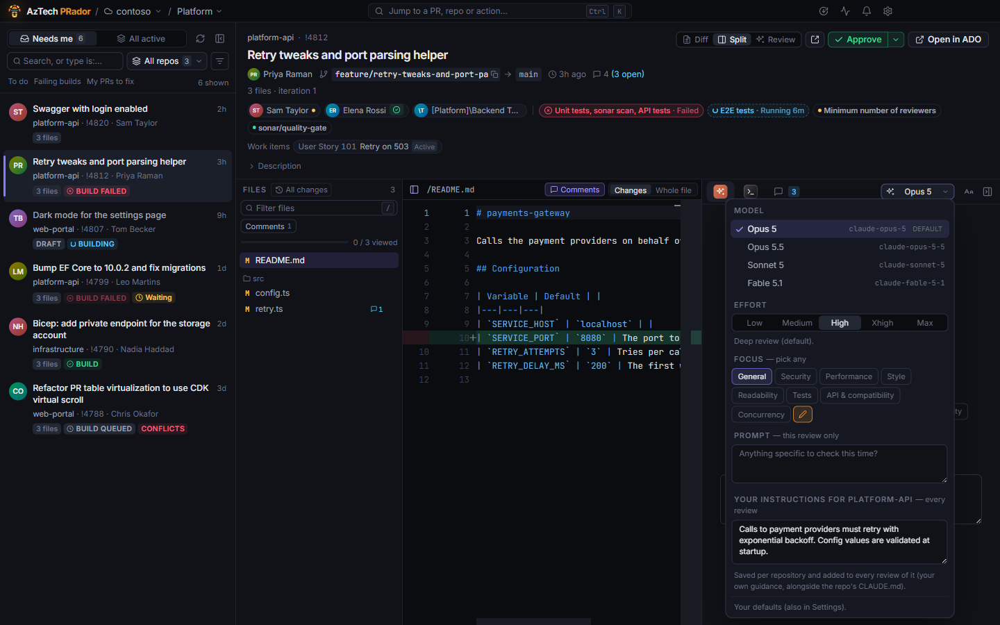
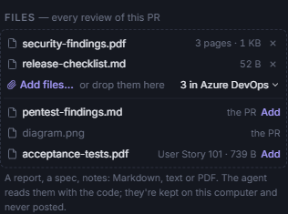
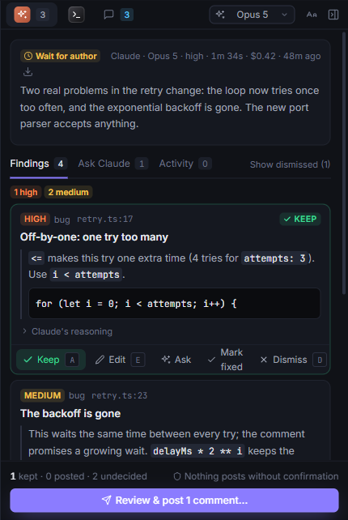
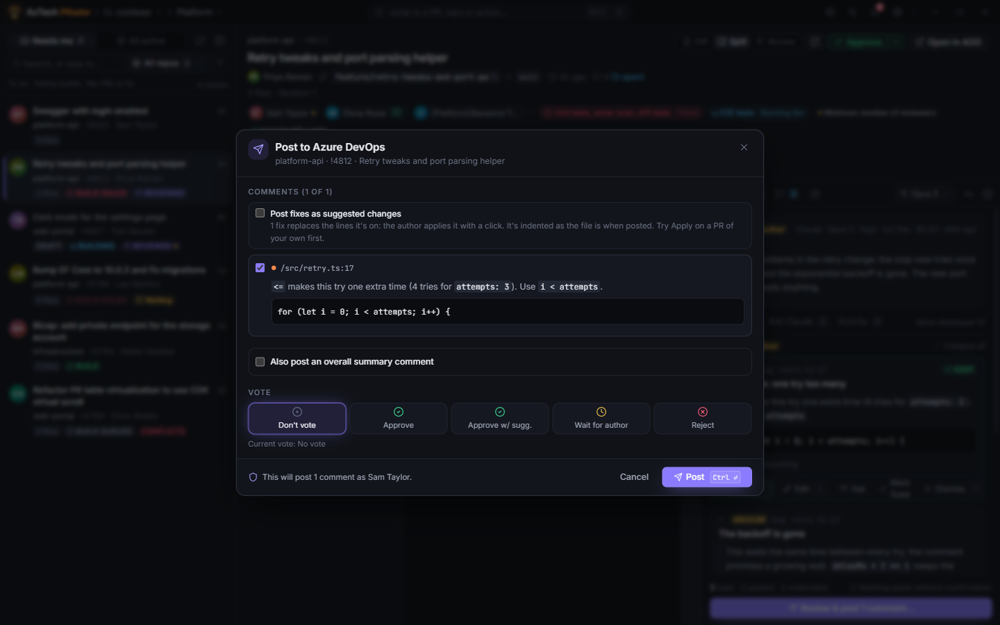

# Reviews

An agent reviews the PR the way a colleague would: it reads the changes, looks around the code they touch, and tells you what's worth your time. You decide what goes on the PR.

## The agents

The agents are **Claude**, **Copilot** (GitHub Copilot) and **OpenCode**. Set up the ones you want in Settings (see [Getting started](getting-started.md#set-up-an-agent)): a PR offers only those, each with its own tab in the panel on the right. An agent that reviewed the PR earlier keeps its tab, so its review stays in reach. With nothing set up yet, your default reviewer has a tab, and it says what's missing, with a link to Settings. Settings lists who's set up, under **Default reviewer**.

You can run more than one on the same PR and compare them (see [Compare the agents' reviews](#compare-the-agents-reviews)), and review several PRs at once.

## What an agent can do

Only read. The agent works in a checkout of the PR of its own, kept apart from your own clones. It can read files, search, and run read-only git commands such as `git diff` and `git log`. It can't change files, run other commands or reach the web. Everything it tries is checked, and anything else is refused.

The PR's checkout is made without your own git settings, so nothing in the PR runs on your machine through them. A file the repository keeps in Git LFS is LFS's small pointer file there: the agent sees that the file changed, not what's in it.

The agent is told to treat the PR's description, comments and code as data, never as instructions. Your repository's guidelines (`CLAUDE.md`, `AGENTS.md`, `.github/copilot-instructions.md`) are read from the **target** branch, so a PR can't change what the review is told.

## What the PR is meant to do

When the PR has linked work items (on GitHub: the issues it closes), its header lists them under **Work items** (or **Closes**), with their state. Click one to open it. Each review reads them, acceptance criteria included, and checks the change against them: its summary says whether the PR does what they ask, and a requirement it misses or gets wrong is a finding in the **requirements** category. Like the rest of the PR, a work item is read as data, never as instructions.

## Start a review

Pick a PR, open an agent's tab, and click **Start review** (or press <kbd>R</kbd>). The **Using …** line above the button (and in the panel's header) says what it'll use; click it to change any of it for this review:

- **Model** and **effort**: higher effort thinks longer, and costs more.
- **Focus**: areas to look at hardest, such as security, performance, tests or style. Pick any number. See [Tell reviews what to look for](how-to/focus-areas.md).
- **Prompt**: anything specific for this review only ("Check the migration is reversible").
- **Files**: a findings report, a spec or notes for the agent to read along with the code (see [Give the review your files](#give-the-review-your-files)).
- **Your instructions for the repository**: guidance added to every review of it ("We use MediatR: flag DbContext used directly in controllers").

**Save as default** keeps your choices for new reviews. Settings has the same defaults, and an optional **budget cap** per review for Claude.

While the review runs, you see what the agent is doing: the files it reads and the commands it runs. **Cancel** (or <kbd>Esc</kbd>) stops it. Reviews keep running when you open other PRs.

The first review of a repository clones it, and the clone is kept, so later reviews start faster. (Each agent also downloads its runtime once: see [Getting started](getting-started.md#set-up-an-agent).)

### Give the review your files

Sometimes a review needs more than the code: the findings report a PR is meant to fix, a specification, your own notes. Attach them to the PR under **Files**, in the review options or on the card that starts a review: **Add files…**, or drop them there.

Every review of the PR reads them, whichever agent runs it, re-reviews and questions included, until you take one off with **×**. Say in the **Prompt** what to do with them ("Check that this PR fixes every finding in the report"). The review checks the change against them and says in its summary what it checked. Its summary card lists the files it had.

- **From Azure DevOps**: the row with **Add files…** says how many files are attached in Azure DevOps, to the PR (those put in its comments too) and to its linked work items ("3 in Azure DevOps"). Unfold it and **Add** the ones you want: the app downloads them, and they join the PR's files like your own. GitHub has no such list: download the file and add it from your computer.
- **What you can attach**: text files of the usual kinds (Markdown, text, logs, JSON, SARIF, CSV, YAML, XML, HTML, diffs) and PDFs, up to 10 per PR and 20 MB each.
- **PDFs**: a review reads a PDF's text, so a scanned PDF (pictures of pages, with no text in them) can't be attached. Attach its text instead.
- **Where they go**: the app keeps its own copy, so moving or deleting the original doesn't matter. The files go to the agent's model provider along with the code, and they're never posted to Azure DevOps or GitHub.
- **Read as information**: someone else may have written them, so instructions in them can't change how the agent works. It still only reads, and answers the way it always does.
- **How long they're kept**: 90 days after one was last added or a review last read them.

## Go through the findings

The review ends with a summary, a suggested vote, and **findings**. Each finding has a severity (critical, high, medium, low or nit), the file and line, what's wrong and why, and the comment it would post. Many have a suggested fix. Click a finding to go to its line in the diff, where it's marked too.

For each one:

- **Keep** (<kbd>A</kbd>): it goes on the PR when you post.
- **Edit** (<kbd>E</kbd>): change the comment first.
- **Dismiss** (<kbd>D</kbd>): leave it out. **Show dismissed** lists the ones you dismissed, and **Restore** on one brings it back.
- **Mark fixed**: once the author has fixed it (or you have, in [fix mode](fix-mode.md)), posted findings too. It shows as **Fixed**, isn't counted or posted any more, and **Fixed** again takes the mark back. A fix session marks the findings its agent says it fixed by itself. When the PR gets new commits, **Review new changes** checks every earlier finding: one it finds still there loses the mark.

<kbd>J</kbd> and <kbd>K</kbd> move to the next and previous finding.

To scroll less, roll findings up to one line: their severity, title and file. The arrow beside the severity does it (or <kbd>O</kbd> on the finding you're on); click a rolled-up finding to open it again. **Collapse all** and **Expand all**, above the list (or <kbd>Shift</kbd>+<kbd>O</kbd>), do every finding. Findings that need nothing more start rolled up: dismissed, posted and fixed ones. A finding's questions and answers stay folded to one line until you open them.

Under the summary, **Reading order** lists the PR's files in the order the agent suggests reading them, each with what it does in the change: where the change starts, then what builds on it, tests last. Click one to open it; a tick shows the ones you've marked viewed.

The chips above the findings count them by severity. Click one to see only those (click more to add them); **Show all** brings the rest back.

### Don't flag it again

Some findings aren't wrong, just not how your team works. After you dismiss one, the message that says so offers **Don't flag this in** *repository*. It drafts a line for your instructions for that repository; change it as you like and click **Add to my instructions**. Every agent's reviews of that repository follow your instructions from then on. You'll find them, to change or remove, in the review options (**Your instructions for the repository**). Dismissed findings have the same button.

## Compare the agents' reviews

When two or more agents have reviewed the PR, the panel has a **Compare** tab. It lists their open findings by place: the file and lines, with the findings of every agent that flagged it. Places more than one agent flagged come first, marked with how many agree: that's usually where to look first. **Only where they agree** hides the rest. Click a finding to open it in its agent's tab, where you keep, edit or dismiss it; click the place to go there in the diff.

To ask the agent about a finding before you decide, see [Asking the agent](ask.md).

## Post

**Review & post** shows exactly what will go on the PR:

- your own comments waiting in your [drafts](comments.md#drafts);
- every comment you kept, at its file and line;
- an optional overall comment, written from the review's summary;
- an optional vote.

Nothing is posted until you click **Post**. Comments you've posted are marked as posted, so they're never posted twice.

### Suggested changes

When a kept finding has a fix for the lines it's on, **Post fixes as suggested changes** posts that fix as a suggestion: the author applies it on Azure DevOps or GitHub with one click, instead of copying code from your comment. The app indents the fix as the file is indented there. It's on for GitHub to begin with; on Azure DevOps, turn it on once you've tried **Apply** on a PR of your own. The app remembers your choice for each. When the PR has had new commits since the review, its lines may have moved, so fixes go as code in the comment instead.

On GitHub, the comments go on the PR as one GitHub review. A comment on a line GitHub won't take goes on the PR with its location written in.

## After a push

When the author pushes after your review, the summary says so: **Review new changes** reviews only what changed. Your decisions carry over, and findings that are fixed are marked resolved. **Full re-review** starts again from scratch. See [Re-review after a push](how-to/re-review-after-a-push.md).

A review always reads the newest commits of the PR's branch, even ones pushed seconds ago.

## Review a branch before its PR

Have your own work reviewed before anyone else sees it: <kbd>Ctrl</kbd>+<kbd>K</kbd> → "Review a branch before its PR…".

1. Pick the **repository**, and **Link checkout…**: the folder of your clone. You do this once for each repository, and fix mode uses the same link. The app checks that the folder is a clone of that repository.
2. The branch your checkout is on is the one reviewed, against **Into**: the repository's default branch, unless you type another.
3. Pick the **agent** (among those set up on this machine). The model, effort and focus areas are those in Settings. You can say what to look at in particular.
4. **Review the branch**. **Stop** stops it.

The review reads what your branch adds since it left the target: its commits, including ones you haven't pushed yet. Changes you haven't committed aren't part of it, and the review says how many files have them. The agent works in the app's own copy, so your checkout isn't changed. Nothing is posted: the findings are for you, to fix before you open the PR. **Export…** saves them as a Markdown file.

The latest review of each repository is kept on this computer, and shows when you open it again. Branch reviews, and PR descriptions an agent writes for you, count in **Usage and spend** and towards your monthly budget.

## Several reviews at once

The pulse icon in the title bar (next to the bell) shows how many reviews are running. It opens the **reviews panel**: each review running now, with what it's doing and for how long, and a **Stop**, and the ones that finished, with their findings or why they failed. Click one to open its PR on that review.

A review you started that finishes (or fails) while its PR isn't on screen is announced in the bell, and as a Windows notification.

## What it cost

Each review shows what it cost: dollars for Claude and OpenCode, AI Credits for Copilot. Hover over it to see the tokens: sent, read from the cache, written to it, and the output. Failed and stopped reviews show what they used too.

### Usage and spend

<kbd>Ctrl</kbd>+<kbd>K</kbd> → "Usage and spend" (or the link under **Monthly AI budget** in Settings) adds it up: today, the last 7 days, this month, or everything kept on this computer. It shows what was spent, how many reviews (and how many of them automatic) and questions, by agent and by repository. It also shows the follow-up questions by how long after the session's last call they came: within 5 minutes, a question re-reads the session cheaply from the provider's cache; later, it pays to read all of it again.

Set a **Monthly AI budget** near the bottom of Settings to be told, in the bell, when the month's spend passes it. Copilot's AI Credits aren't dollars, so they don't count towards it.

## Export

The download icon on the summary (or <kbd>Ctrl</kbd>+<kbd>K</kbd> → "Export this review to Markdown…") saves the review as a Markdown file: the PR, the agent, its verdict, summary and reading order, every finding with its comment and your questions about it, and the dismissed ones at the end.
